<h1>Vikas Kushwaha</h1>

<strong>Software Engineer</strong> · Full-stack web developer working with <strong>JavaScript, TypeScript, React, Next.js and Node.js</strong>

<h3><code>vikas@github ~ $ ./contributions.sh</code></h3>

  

<h3><code>vikas@github ~ $ whoami</code></h3>

<table>
  <tr>
    <td valign="top"></td>
    <td valign="top"></td>
  </tr>
</table>

I'm Vikas Kushwaha, a software engineer building web apps at Square Yards. 
I work across the stack: React, Next.js and Tailwind CSS on the frontend, Node.js, MongoDB and MySQL on the backend. 
Right now I'm learning Next.js internals and React Server Components.

 

<h3><code>vikas@github ~ $ ls ./projects</code></h3>

<table>
  <tr>
    <td><a href="https://vikaskushwaha.vercel.app/"><strong>Portfolio</strong></a></td>
    <td>My developer portfolio (<a href="https://github.com/Tracevikas/portfoliov2">source</a>)</td>
  </tr>
  <tr>
    <td><a href="https://github.com/Tracevikas/scrawlspace"><strong>Scrawlspace</strong></a></td>
    <td>Real-time multiplayer whiteboard with live cards: to-dos, code snippets, tables, Mermaid diagrams and runnable API requests, end-to-end encrypted</td>
  </tr>
</table>

 

<h3><code>vikas@github ~ $ cat ./projects/scrawlspace.md</code></h3>

### ✏️ Scrawlspace

A hand-drawn infinite whiteboard with **live cards** (to-dos, code snippets, tables and runnable API requests), real-time multiplayer with **end-to-end encryption**, no sign-in. It also hosts a suite of browser-only developer tools.

**What it does**

- **Canvas engine built from scratch:** infinite pan/zoom, rough sketchy shapes, pressure-style pen, text, images, undo/redo, box-select, layers, lock, search
- **Live cards:** notes, checklists, code with syntax highlighting for 13 languages, editable tables, and an **API client card** that sends requests through a server-side proxy (no CORS problems), with curl import/export
- **Multiplayer:** shareable rooms with live cursors. Boards are encrypted in the browser with **AES-GCM**, and the key stays in the URL fragment, so the server never sees it
- **Multiple boards** with live previews, encrypted read-only snapshot links, PNG and `.scrawl` export
- **Installable PWA:** works offline, opens `.scrawl` files, prompts when an update is ready
- **Tool hub:** diff checker, JSON viewer, CSS formatter, JWT/hash/UUID/encoding/timestamp utilities, an in-browser **PDF editor** (sign, highlight, merge, reorder) and image tools (compress, resize, crop, WebP/AVIF via WebAssembly, SVG optimizer, favicon and OG-image generators)

**How it's built**

| Layer | Tech |
|---|---|
| Frontend | React 19, TypeScript, Vite, a custom canvas renderer, Rough.js, perfect-freehand, Motion for animation |
| Realtime | Socket.IO relay. Clients encrypt and decrypt everything with the Web Crypto API |
| Backend | Node.js and Express: collab relay, encrypted blob storage, an API proxy with SSRF protection (blocks private IPs, checks DNS and redirects) |
| Storage | localStorage + IndexedDB on the client; Vercel Blob for encrypted rooms and links |
| In-browser processing | pdf.js + pdf-lib, libavif (WASM in a Web Worker), SVGO, Prism |
| Deploy | Vercel (static app + serverless functions); Render for the WebSocket server |

Each tool lives in its own folder and is registered in a single `registry.ts`. Routing, the hub card and a separate lazy-loaded bundle are generated from that one entry.

 

<h3><code>vikas@github ~ $ ls ./stack</code></h3>

  

<h3><code>vikas@github ~ $ cat contact.txt</code></h3>

